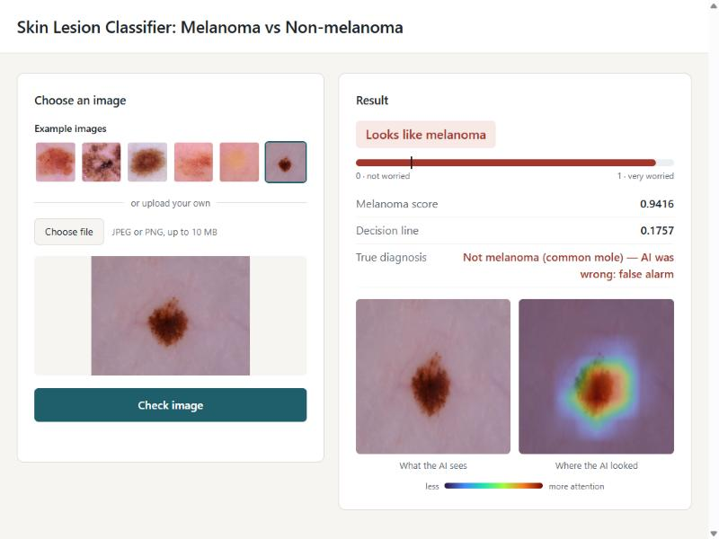

<div align="center">

# Cross-Modality Robustness of Explainable Deep Learning for Melanoma Detection

**Can dermoscopy-trained convolutional neural networks generalise to smartphone images?**




<sub>Our demo app. Here the model gives a false alarm on a common mole — we show its mistakes too.</sub>

</div>

---

## 🔍 About

Melanoma is a dangerous skin cancer, and finding it early matters. Most AI models for melanoma
learn from **dermoscopy images** — close-up photos taken through a skin magnifier. In real life,
though, people often have only an ordinary camera or smartphone photo.

In this project we asked two questions:

1. **Does the model still work** when the image type changes from dermoscopy to an ordinary photo?
2. **Do its explanations** (heatmaps showing where it looked) still make sense?

We trained a **ResNet-50** to classify **melanoma vs non-melanoma**, tested it on several
public datasets, and built a small web app that shows the prediction together with a
**Grad-CAM** heatmap.

## 📊 Key results

| | Result |
|---|---|
| 🎯 Melanomas found on the HAM10000 test set | **92%** (157 of 170) |
| ✅ Non-melanomas correctly cleared | **66%** (911 of 1,378) |
| 📷 Ordinary (non-magnified) photos | the model finds **far fewer** melanomas |
| 🧠 Models compared | ResNet-50, EfficientNet-B3, DenseNet-121 — no single clear winner |

We set the decision threshold on separate validation images so that the model catches 95% of
melanomas. This means fewer missed cancers, but more false alarms — a trade-off we chose on purpose.

> ⚠️ This is a research project, not a medical tool. It has not been tested in a clinic.

## 🚀 Run the demo

**Requirements:** Windows, Python 3.10, and the packages listed in `research_v1/env/`
(PyTorch, timm, OpenCV, Pillow, NumPy).

```bash
# 1. Create the environment
python -m venv research_v1/.venv_model
research_v1/.venv_model/Scripts/pip install -r research_v1/env/requirements_model.txt

# 2. Start the demo
demo/start_demo.bat
```

Then open **http://127.0.0.1:8765**, pick one of the example images and press **Check image**.

> 📦 **Model weights are not included** in this repository because of their size.
> They are available on request.

## 🗂️ Project structure

```
├── research_v1/
│   ├── src/rv1/        # All research code: data, training, evaluation, XAI, statistics
│   ├── tests/          # Unit and integration tests
│   ├── configs/        # Frozen configuration for every experiment
│   ├── manifests/v1/   # Dataset lists and train / validation / test splits (no images)
│   ├── tools/          # Manifest builder and environment inventory
│   ├── env/            # Recorded package versions
│   └── docs/           # Stage-by-stage reports and protocol addenda
├── demo/
│   ├── backend/        # Python web server and model service
│   ├── frontend/       # HTML, CSS and JavaScript of the web app
│   ├── test_images/    # Six HAM10000 test examples (CC BY-NC 4.0)
│   └── presentation/   # Slides and speech
├── code/               # Earlier (v0) prototype, kept for reference
└── docs_assets/        # Images used in this README
```

## 📄 License

The code is released under the [MIT License](LICENSE).
Datasets are not included and keep their own licences.
